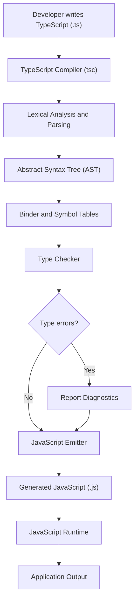

# TypeScript Architecture and How It Works

## 1. What Is TypeScript?

TypeScript is a strongly typed programming language built on top of JavaScript. It adds static type checking, interfaces, type aliases, generics, and other developer tools.

TypeScript code is typically compiled into JavaScript before execution.

**Important:** TypeScript types are primarily a compile-time feature. They are not automatically enforced at runtime.

---

## 2. TypeScript Architecture



Note: This is a simplified conceptual diagram. The compiler has additional stages and internal processes, and emitting JavaScript can still occur when type errors exist unless `noEmitOnError` prevents it.

---

## 3. How the TypeScript Compiler Works

### Stage 1: Source Code

A developer writes code in a `.ts` file.

```typescript
let username: string = "Alex";
let age: number = 25;

console.log(username, age);
```

The source contains type annotations that help TypeScript understand the intended data types.

### Stage 2: Parsing

The compiler parses the source code and creates an Abstract Syntax Tree (AST).

The AST represents the structure of the program, including variables, functions, expressions, and statements.

### Stage 3: Binding

The binder identifies declarations and creates symbols that represent variables, functions, classes, and other named entities.

These symbols help the compiler understand scopes and resolve references between declarations.

### Stage 4: Type Checking

The type checker checks whether the code is consistent with the declared and inferred types.

```typescript
let age: number = 25;

age = "twenty-five"; // Type error
```

The compiler reports that a string cannot be assigned to a number.

TypeScript catches this problem during development or compilation rather than automatically enforcing the annotation at runtime.

### Stage 5: JavaScript Emission

The compiler generates JavaScript and removes TypeScript-only syntax.

TypeScript input:

```typescript
function multiply(a: number, b: number): number {
  return a * b;
}
```

Conceptual JavaScript output:

```javascript
function multiply(a, b) {
  return a * b;
}
```

The exact generated output depends on compiler options and the TypeScript features being used.

### Stage 6: JavaScript Execution

The resulting JavaScript is executed by a JavaScript runtime, such as:

- A browser's JavaScript engine
- Node.js
- Another compatible JavaScript runtime

The runtime executes JavaScript, not TypeScript type annotations.

---

## 4. Type Checking Versus Runtime Validation

TypeScript provides compile-time checks, but it does not automatically validate external data.

```typescript
interface User {
  name: string;
  age: number;
}

const user: User = {
  name: "Alex",
  age: 25
};
```

The compiler checks the structure of this object.

However, data received from an API, a JSON file, or user input must be validated at runtime if its correctness matters.

For example:

```typescript
const data: unknown = JSON.parse(
  '{"name":"Alex","age":25}'
);

if (
  typeof data === "object" &&
  data !== null &&
  "name" in data &&
  typeof data.name === "string" &&
  "age" in data &&
  typeof data.age === "number"
) {
  console.log(data.name);
}
```

Here, the program validates the external data at runtime before using it as a valid user object.

---

## 5. TypeScript Project Structure

```text
typescript-project/
├── src/
│   └── index.ts
├── dist/
│   └── index.js
├── package.json
├── package-lock.json
└── tsconfig.json
```

- `src/`: TypeScript source code.
- `dist/`: Generated JavaScript output.
- `package.json`: Project metadata and dependencies.
- `package-lock.json`: Records the resolved npm dependency tree.
- `tsconfig.json`: Compiler configuration.

The `dist/` directory is generated when the compiler emits JavaScript. It does not need to exist before compilation.

---

## 6. Setting Up TypeScript

### Step 1: Initialize the project

```bash
mkdir typescript-project
cd typescript-project
npm init -y
```

### Step 2: Install TypeScript

```bash
npm install --save-dev typescript
```

### Step 3: Create the compiler configuration

```bash
npx tsc --init
```

Configure `tsconfig.json` for a basic Node.js project:

```json
{
  "compilerOptions": {
    "target": "ES2022",
    "module": "NodeNext",
    "moduleResolution": "NodeNext",
    "rootDir": "./src",
    "outDir": "./dist",
    "strict": true,
    "esModuleInterop": true,
    "forceConsistentCasingInFileNames": true,
    "skipLibCheck": true
  },
  "include": ["src/**/*.ts"],
  "exclude": ["node_modules", "dist"]
}
```

### Step 4: Create the source file

Create `src/index.ts`:

```typescript
interface User {
  id: number;
  name: string;
}

function greet(user: User): string {
  return `Hello, ${user.name}!`;
}

const user: User = {
  id: 1,
  name: "Alex"
};

console.log(greet(user));
```

### Step 5: Compile and execute

Compile TypeScript:

```bash
npx tsc
```

Execute the generated JavaScript:

```bash
node dist/index.js
```

Expected output:

```text
Hello, Alex!
```

To check types without generating JavaScript:

```bash
npx tsc --noEmit
```

---

## 7. TypeScript Workflow Summary


1. Write TypeScript code.
2. The compiler parses and analyzes it.
3. The type checker reports type errors.
4. The compiler emits JavaScript according to the configuration.
5. A JavaScript runtime executes the generated code.

**Remember:** TypeScript helps developers detect mistakes earlier, improves editor support, and makes large codebases easier to maintain. It does not replace JavaScript, and its type annotations do not automatically provide runtime validation.